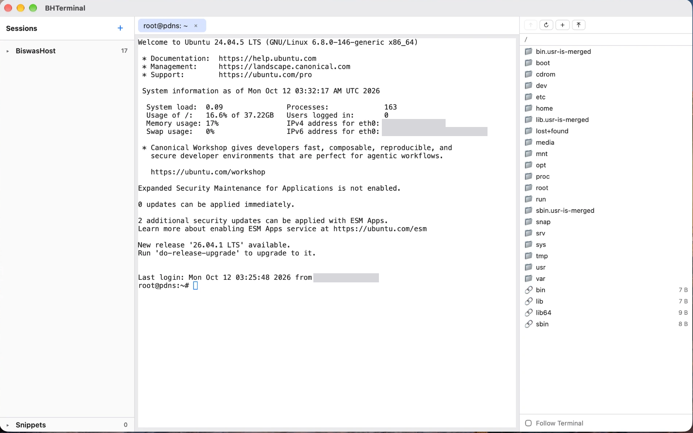

<h1 align="center">BHTerminal</h1>

<p align="center">
  A free, open-source <b>SSH / SFTP / VNC client</b> for <b>macOS, Windows, and Linux</b>.<br>
  A MobaXterm/Termius-style workspace — session tree, terminal, file browser, and<br>
  remote desktops in one window. Imports your MobaXterm sessions.
</p>

<p align="center"><i>Built and maintained by <a href="https://www.biswashost.com">BiswasHost</a> 🇧🇩</i></p>

<p align="center">
  
</p>

---

## Platforms

Since **v2.0.0** all three are built from one source — a Rust core, a Tauri
shell, and your system's own `ssh` — so a feature lands everywhere at once.

| OS | Download | Notes |
|----|----------|-------|
| 🍎 **macOS** | `BHTerminal_<version>_aarch64.dmg` (Apple silicon) · `_x64.dmg` (Intel) | Ad-hoc signed, not notarised — see [first launch](#first-launch-on-macos) |
| 🪟 **Windows** | `BHTerminal_<version>_x64-setup.exe` · `_arm64-setup.exe` | Installer only, no `.msi` |
| 🐧 **Linux** | `.deb` and `.rpm`, `amd64`/`x86_64` and `arm64`/`aarch64` | WebKitGTK 4.1 |

Everything is on the
[**latest release**](https://github.com/wpexpertinbd/BHTerminal/releases/latest).

The original **macOS-only Swift app** lives on in [`macos/`](macos/). It is the
reference the Rust version was ported from, and is no longer the shipping build.

## Features

- **Sessions sidebar** — folders and hosts, double-click to connect.
- **Real SSH terminal** — runs your system `ssh`, so `~/.ssh/config`, the agent,
  `ProxyJump` and 2FA all work. Tabs, **split panes**, **broadcast typing** to every pane in a
  tab, snippets, and **session recording** to a file.
- **SFTP browser** in the same tab, on the same login — with a path that
  **follows your terminal's directory**, taken from the window title rather than
  injected into your shell. Right-click for the rest: **edit a file in the window
  or in your own editor** (saving there uploads it back), download, new file, new
  folder, rename, delete, and **compress or extract on the server** so a large
  folder is never pulled down and pushed back.
- **VNC** remote desktops in the same tabbed window.
- **Port forwards** — local, remote and SOCKS, started per host with their live state.
- **Saved passwords and key passphrases**, encrypted on your computer and typed in
  for you when the server asks.
- **Import from MobaXterm** — a `.mxtsessions` export, a plain `.mobaconf` or
  `MobaXterm.ini`, and the stored-passwords export (which brings the passwords with it).
  An OpenSSH `~/.ssh/config` works too.
- **Backup and restore** — write every host, folder and snippet to one file, and merge
  it back on another computer without deleting anything added since. This is how you move
  a host list between the macOS, Windows and Linux builds. Saved passwords can be
  included, and are then always encrypted (AES-GCM under PBKDF2) with a passphrase you choose.
- **Closing the window does not quit it.** BHTerminal stays in the menu bar with your
  sessions, forwards and SFTP connections alive; click the icon to bring the window
  back, and **Quit BHTerminal** from its menu when you really mean it.
- **Update check** — finds the right installer for your machine and opens it in your
  browser. It never downloads or runs anything itself; see [`SECURITY.md`](SECURITY.md).
- **Right-click the terminal** for copy, copy everything, paste, select all and
  clear; right-click the file browser for everything described above.
- **Secure by design** — host-key verification, an ssh argument allow-list, and imports
  treated as untrusted input. Details in [`SECURITY.md`](SECURITY.md).

## Upgrading from v1.x on macOS

The old macOS app was a different application to the system — a different
bundle identifier — so installing v2 does **not** replace it. Installing over
the top leaves two copies of BHTerminal on the Mac. Do this instead:

1. **In the old app:** `File ▸ Export Backup…`, and tick **include saved
   passwords**. You will be asked for a passphrase; the file is encrypted with
   it, and there is no way to open it without that passphrase.
2. **Remove the old app.** Drag **BHTerminal** from Applications to the Trash
   (macOS asks for your password, because the old installer wrote it as root).
3. **Install** `BHTerminal-<version>-universal.pkg` from the
   [latest release](https://github.com/wpexpertinbd/BHTerminal/releases/latest).
4. **In the new app:** **＋ ▸ Restore a backup…**, choose that file, enter the
   passphrase.

Your hosts and folders are read from the same place the old app kept them, so
they are usually there already — the backup is what carries your **saved
passwords** across, because v1 kept them in the macOS Keychain and v2 keeps
them in its own encrypted vault.

This is also the way to move a host list to the Windows or Linux build: the
backup file is the same format on every platform. A private key file is the one
thing that does not travel — it stays on the machine it is on, and a restore
tells you which hosts are pointing at a key that is not on this computer.

## First launch on macOS

The app is signed, but **not notarised** — that needs a paid Apple account, and this
is free software. Open it, click **Done** on the warning, then go to **System Settings
▸ Privacy & Security** and click **Open Anyway**. You only do this once.

## How it works

One Rust core, one shell, three platforms:

- **[`crates/bhterm-core`](crates/bhterm-core)** — everything portable, and nothing
  else: the data model, the ssh argument builder and its allow-list, an SFTP v3
  client, the credential vault, the backup format, and the import parsers. No UI,
  no Tauri, and no platform guessing — the shell passes in every path. It is where
  the tests live.
- **[`app/`](app)** — the Tauri shell (pty, SFTP sessions, the VNC bridge, the
  vault, forwards) and a React front end with xterm.js and noVNC.
- **[`macos/`](macos/)** — the original Swift app, kept as the reference it was
  ported from.
- **[`docs/PORTING.md`](docs/PORTING.md)** — the OS-neutral spec and the security
  rules, written when each OS was going to get its own shell. Still the contract
  for the behaviour, and worth reading before changing it.

The terminal runs your system's `ssh` rather than a bundled SSH library, which is
why your config, your agent, `ProxyJump` and 2FA simply work. The one real
platform difference: **Windows OpenSSH has no connection sharing**, so there the
file browser signs in separately instead of riding the terminal's login — the app
says so rather than behaving differently in silence.

The saved-session file is the same on every platform, so your sessions move
between them.

## Repository layout
```
.
├── crates/bhterm-core/  # portable Rust core (model, ssh, sftp, vault, import) + tests
├── app/                 # Tauri shell (Rust) + React front end — the shipping app
├── docs/PORTING.md      # the OS-neutral spec and security contract
├── macos/               # the original Swift app, kept as reference
├── LICENSE           # MIT
├── SECURITY.md
└── DISCLAIMER.md     # not affiliated with MobaXterm / Termius
```

## License
MIT — see [`LICENSE`](LICENSE). Not affiliated with, endorsed by, or derived from
MobaXterm, Termius, or any other product — see [`DISCLAIMER.md`](DISCLAIMER.md).

## ☕ Support

This project is free and open-source. If it made your server work easier, you can
**buy me a coffee** — it genuinely helps me keep building and maintaining free
tools like this. 🙏

- **bKash/Nagad** (Personal · *Send Money*): **`01710378396`**

ধন্যবাদ! / Thank you!

<p align="center">Made with care by <a href="https://www.biswashost.com">BiswasHost</a> 🇧🇩</p>
